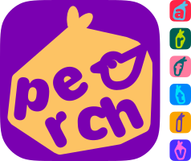

# perch

perch lets your AI agent use the browser you already have open on your Mac, while you keep working in it. Chrome, Arc and the other Chrome-family browsers, and Safari, with no extension and no debug flags. It never takes your screen without asking.

## Install

```bash
curl -fsSL https://raw.githubusercontent.com/sryo/perch/main/install.sh | bash
```

It sets perch up in Claude Code, Codex and GitHub Copilot, whichever you have. Restart your agent; `perch` should appear in its MCP listing.

The first time, allow two things once: macOS asks whether the app running your agent may control your browser (Automation), and in the browser you turn on Allow JavaScript from Apple Events.

## Use

Ask your agent for things in a tab you have open: "fill this application from my resume", "what does this page say about pricing?", "click through the signup and tell me what breaks".


## What it never does

- Take your foreground. It never brings a window to the front, switches your tab or moves your cursor unless you allowed it when perch asked. It refuses an action rather than steal your screen.
- Report what didn't happen. It says what the page kept, like the text a field still holds or the option a menu picked, not what it sent.

## Works with

- [avis](https://github.com/sryo/avis): pin comments on a live page and hand them to your agent. perch was built for it.
- [figma-cdp](https://github.com/sryo/figma-cdp): works in your open Figma tabs without Chrome asking you to allow remote debugging.
- [loft](https://github.com/sryo/loft): a hidden screen for a window in your own profile, out of your way.
- [rooms](https://github.com/sryo/rooms): browsers of the agent's own, for its own sign-ins or work that goes on while your Mac is locked.
