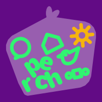

# perch

perch lets your AI agent use the browser you already have open on your Mac: Chrome, Arc and the other Chrome-family browsers, and Safari, with no extension and no debug flags. Built for [avis](https://github.com/sryo/avis). It also lets [figma-cdp](https://github.com/sryo/figma-cdp) work in your open Figma tabs without Chrome asking you to allow remote debugging. It drives [rooms](https://github.com/sryo/rooms) too, browsers of the agent's own that stay signed in and leave your windows alone. With [loft](https://github.com/sryo/loft) up, it can open a browser window of its own on a hidden screen, where nothing covers or slows it and it stays out of your way.

## Install

```bash
curl -fsSL https://raw.githubusercontent.com/sryo/perch/main/install.sh | bash
```

Restart your agent; `perch` should appear in its MCP listing.

The first time, allow two things once: macOS asks whether the app running your agent may control your browser (Automation), and in the browser you turn on Allow JavaScript from Apple Events.

## Use

Ask your agent for things in a tab you have open: "fill this application from my resume", "what does this page say about pricing?", "click through the signup and tell me what breaks".
